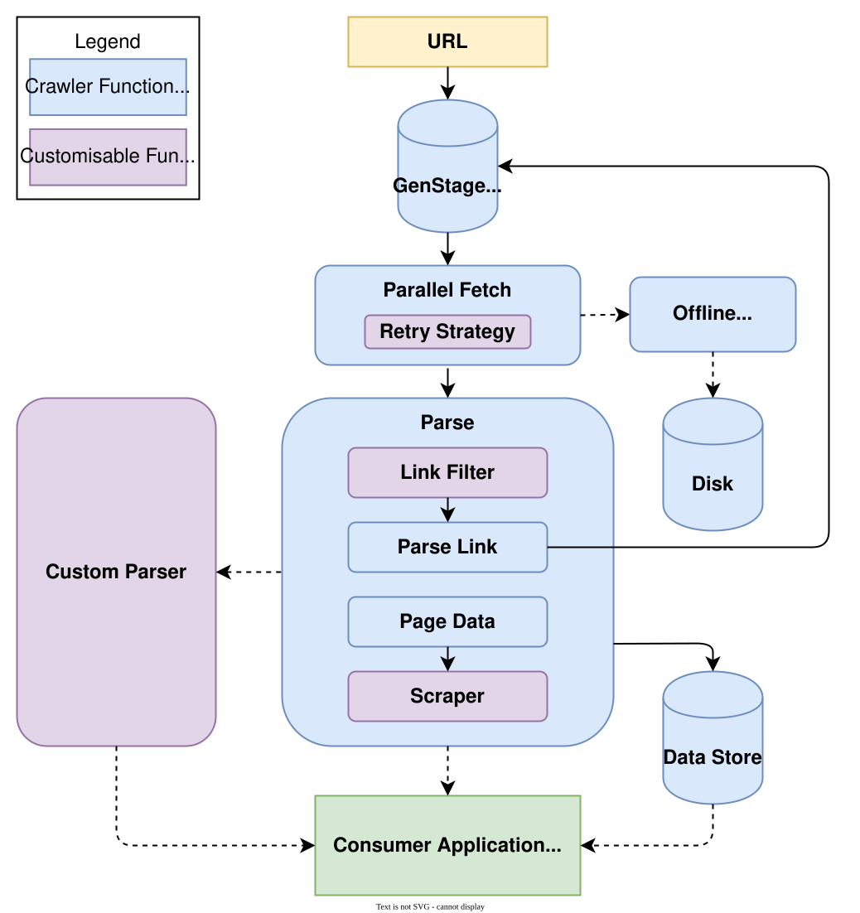

# Crawler

[](https://github.com/fredwu/crawler/actions)
[](https://codebeat.co/projects/github-com-fredwu-crawler-master)
[](https://coveralls.io/github/fredwu/crawler?branch=master)
[](https://hex.pm/packages/crawler)
[](https://hexdocs.pm/crawler/)
[](https://hex.pm/packages/crawler)
[](https://github.com/fredwu/crawler/blob/master/LICENSE.md)
[](https://github.com/fredwu/crawler/commits/master)

A high performance web crawler / scraper in Elixir, with worker pooling and rate limiting via [OPQ](https://github.com/fredwu/opq).

## Features

- Crawl assets (javascript, css and images).
- Save to disk.
- Hook for scraping content.
- Restrict crawlable domains, paths or content types.
- Limit concurrent crawlers.
- Limit rate of crawling.
- Set the maximum crawl depth.
- Set timeouts.
- Set retries strategy.
- Set crawler's user agent.
- Manually pause/resume/stop the crawler.

See [Hex documentation](https://hexdocs.pm/crawler/).

## Architecture

Below is a very high level architecture diagram demonstrating how Crawler works.



The implementation separates these responsibilities:

- `Crawler.Queue` owns each managed queue's workers and rate limiter. `Crawler.QueueHandler` enqueues work, and `Crawler.Worker` runs each fetch and parse.
- `Crawler.Store` coordinates run authority, page slots, bounded admission, request reuse, and export status. The export owner seals the manifest and controls archive publication through `Crawler.Export.Filesystem`.
- `Crawler.Fetcher` applies crawl policy and records responses. `Crawler.HTTP` checks each redirect before Req follows it.
- The URL module validates browser host spellings and defines page identity. The charset module decodes text responses before parsing and saving.
- `Crawler.Parser` discovers links and invokes the scraper. Image buttons, audio and video preloads, document and worker preloads, paint and audio worklets, CSS `image()`, and the older touch icons are saved with the page. `Crawler.Analysis` supplies immutable source facts and occurrences to discovery and rendering; HTML and XML use separate modes, and source edits are applied in one batch. A source map named by a crawled script or stylesheet, or by its `SourceMap` / `X-SourceMap` header, is saved with the sources that map names. `Crawler.Linker` resolves URL references. [`Crawler.Export.Paths`](lib/crawler/export/paths.ex) assigns artifact paths, and `Crawler.Snapper` publishes standalone files through `Crawler.Export.Filesystem`.

A scope shares seen URLs and the page budget. Its generation prevents old workers from updating a reset scope. Queue ownership determines which processes `Crawler.stop/1` shuts down; callers can also supply an external queue.

Reusing returned options for the same run keeps its absolute deadline. An explicit
force reset or selection of another scope starts a new finite run deadline.

## Usage

```elixir
url = "https://elixir-lang.org"
{:ok, opts} = Crawler.crawl(url, max_depths: 2, store: Crawler.Store)
```

Crawling is asynchronous. Poll `Crawler.running?(opts)` until it returns `false` while the crawl is not paused, then read a processed page. Inactivity does not establish success; for a managed archive, check `Crawler.export_status/1` before using its files:

```elixir
page = Crawler.Store.find_processed({url, opts[:scope]})
```

This returns `nil` if the page was not processed. With the default `store: nil`, the Registry omits response bodies, options, and analysis context. A returned, resource-funded `Page` can still carry them, and [`Crawler.Store.SourceManager`](lib/crawler/store/source_manager.ex) can retain bounded source data for reuse. Enable `store: Crawler.Store` to read bodies through the Store API or its `Crawler.Store.DB` registry. You can also use a [custom scraper or parser](#custom-modules), or set `:save_to` to create a managed archive.

Page identity keeps one trailing DNS dot and normalizes other browser-equivalent domain and IPv4 spellings. A path pipe, a bare percent sign, and the query characters backtick, brace, pipe, backslash, and caret stay literal and do not share a page with the percent-encoded form. Other bytes that require escaping share an identity with that form; escaped separators remain distinct. HTTP requests encode Unicode and the remaining unsafe path or query bytes into ASCII while preserving valid escapes and an explicit empty query (`?`). Saved links keep fragments after URL sanitization and escape delimiter bytes so those fragments preserve HTML, CSS, and JavaScript source boundaries.

## Configurations

| Option        | Type    | Default Value               | Description                                                                                                                                                                               |
| ------------- | ------- | --------------------------- | ----------------------------------------------------------------------------------------------------------------------------------------------------------------------------------------- |
| `:assets`     | list    | `[]`                        | Whether to fetch any asset files, available options: `"css"`, `"js"`, `"images"`.                                                                                                         |
| `:javascript_goal` | atom | `:module`                 | Source goal for direct JavaScript crawls. Use `:script` for classic JavaScript.                                                                                                          |
| `:save_to`    | string  | `nil`                       | Fresh destination for a complete managed archive; its parent must be an existing isolated root.                                                                                                                                         |
| `:workers`    | integer | `10`                        | Maximum number of concurrent workers for crawling.                                                                                                                                        |
| `:interval`   | integer | `0`                         | Rate limit control - number of milliseconds before crawling more pages, defaults to `0` which is effectively no rate limit.                                                               |
| `:max_depths` | integer | `3`                         | Maximum nested depth of pages to crawl.                                                                                                                                                   |
| `:max_pages`  | integer | `:infinity`                 | Maximum amount of pages to crawl.                                                                                                                                                         |
| `:timeout`    | integer or `:infinity` | `5000`          | HTTP receive timeout in milliseconds, passed to Req as `:receive_timeout`.                                                                                                              |
| `:retries`    | integer | `2`                         | Number of retries for tagged HTTP failures. The default retrier propagates callback and programming exceptions without retrying.                                                          |
| `:store`      | module  | `nil`                       | Module for storing the crawled page data and crawling metadata. You can set it to `Crawler.Store` or use your own module, see `Crawler.Store.add_page_data/3` for implementation details. |
| `:force`      | boolean | `false`                     | Reset the scope before a root crawl, removing its pages and counters and invalidating its previous workers. Use an explicit `:scope` to refresh an existing crawl.                       |
| `:scope`      | term    | unique per crawl            | Seen URLs and `:max_pages` belong to one scope. Each crawl gets its own scope unless you pass one. Pass the same scope to share them.                                                      |
| `:user_agent` | string  | `Crawler/x.x.x (...)`       | User-Agent value sent by the fetch requests. The product token selects the matching `robots.txt` group. A URL in the comment is not a product token.                                      |
| `:respect_robots` | boolean | `true`                 | Honour `robots.txt`, `nofollow`, meta robots, and `X-Robots-Tag`. A missing robots file allows the crawl. A server error blocks that fetch, and the file is requested again. A redirect is refused when the next URL is disallowed, including a script, stylesheet, image, or sitemap file. A disallowed sitemap file is not downloaded. Checking one URL on another host does not read that host's sitemaps. A sitemap URL this crawl will not fetch does not use a page slot. Set `false` to follow disallowed paths, redirects, and nofollow links without requesting the file. |
| `:max_body`   | integer | `10485760`                  | Maximum decoded response size in bytes. A larger response is discarded and is not retried.                                                                                                |
| `:url_filter` | module  | `Crawler.Fetcher.UrlFilter` | Custom URL filter. The default keeps ordinary links on the seed site. A custom module replaces that decision.                                                                             |
| `:retrier`    | module  | `Crawler.Fetcher.Retrier`   | Custom fetch retrier, useful for retrying failed crawls, nullifies the `:retries` option.                                                                                                 |
| `:modifier`   | module  | `Crawler.Fetcher.Modifier`  | Custom modifier, useful for adding custom request headers or options.                                                                                                                     |
| `:req_options` | keyword | `[]`                        | Advanced [`Req` request options](https://hexdocs.pm/req/Req.html#new/1-options) forwarded to the HTTP client.                                                                            |
| `:scraper`    | module  | `Crawler.Scraper`           | Custom scraper, useful for scraping content as soon as the parser parses it.                                                                                                              |
| `:parser`     | module  | `Crawler.Parser`            | Custom parser, useful for handling parsing differently or to add extra functionalities.                                                                                                   |
| `:encode_uri` | boolean | `false`                     | When set to `true` apply the `URI.encode` to the URL to be crawled.                                                                                                                       |
| `:queue`      | pid or atom | `nil`                   | Pass an `OPQ` pid or registered name to share a queue. An unavailable name returns `{:error, {:queue_unavailable, name}}`. `Crawler.stop/1` leaves an externally created queue running.     |

HTML script references select the script or module goal from their script type. JavaScript imports use the module goal. Discovery and offline rewriting use the same goal.

### Finite work limits

The following built-in defaults come from [`Crawler.Limits`](lib/crawler/limits.ex) and [`Crawler.Options`](lib/crawler/options.ex). Pass options to `Crawler.crawl/2`, or configure their application defaults under `:crawler`. Options are validated before admission. New work limits require positive integers; `:max_body` also accepts zero. `:max_pages` and the receive `:timeout` still accept `:infinity`. Workers must be positive; depth, interval, and retry counts must be non-negative integers.

| Option | Default | Bound |
| --- | ---: | --- |
| `:max_pending` | `1_024` | Pending admitted jobs. |
| `:max_frontier_bytes` | `16_777_216` | Retained frontier payload and metadata bytes. |
| `:max_representations` | `10_000` | Distinct effective request representations. |
| `:max_interpretations` | `20_000` | Retained jobs for interpretation and work contexts. |
| `:max_retained_bytes` | `67_108_864` | Accounted retained crawl resources, including reservations. |
| `:max_queue_tickets` | `32` | Outstanding Crawler notifications per queue. |
| `:max_tracked_queues` | `1_024` | Caller ceiling for admitting new physical queues; see below. |
| `:max_control_documents` | `128` | Control-document work, including sitemap traversal. |
| `:max_control_bytes` | `33_554_432` | Aggregate control-response bytes. |
| `:max_control_depth` | `16` | Nested control-document traversal depth. |
| `:max_control_entries` | `50_000` | Entries in a control document. |
| `:max_control_token_bytes` | `65_536` | Control-document token and address bytes. |
| `:max_analysis_bytes` | `20_000_000` | Continuing analysis allocation budget and rendered-output cap. |
| `:max_analysis_regions` | `100_000` | Source regions. |
| `:max_analysis_depth` | `16` | Nested analysis regions. |
| `:max_analysis_facts` | `200_000` | Source facts. |
| `:max_analysis_occurrences` | `100_000` | Resolved source occurrences. |
| `:max_analysis_edits` | `100_000` | Source edits. |
| `:max_xml_depth` | `256` | XML element depth. |
| `:max_xml_tokens` | `100_000` | XML tokens. |
| `:max_xml_attributes` | `1_024` | Attributes per XML element. |
| `:max_css_work` | `100_000` | CSS graph work. |
| `:max_css_pictures` | `10_000` | Resolved CSS pictures. |
| `:max_css_depth` | `256` | CSS graph depth. |
| `:attempt_timeout` | `30_000` | Attempt deadline in milliseconds. |
| `:run_timeout` | `600_000` | Run deadline in milliseconds. |

Per-crawl options cannot enlarge the Store's shared resource ceilings. The queue-ticket service reads the application defaults for `:max_queue_tickets` and `:max_tracked_queues` when it starts; the built-in defaults are 32 and 1,024. A crawl's `:max_tracked_queues` can tighten the service roster ceiling for admitting a new queue, but cannot raise it or remove an existing enrollment. Reusing an enrolled queue does not consume another roster slot, even when the caller selects a smaller roster ceiling.

A queue's selected ticket cap stays fixed for its physical lifetime. Requesting a different cap returns `{:error, {:queue_capacity_conflict, existing_cap}}`; a cap above the service ceiling returns `{:error, {:limit, :max_queue_tickets}}`. A full roster returns `{:error, {:limit, :max_tracked_queues}}`. Each issued ticket remains charged until acknowledgement or queue death, including across scope resets. An enrolled queue keeps its roster slot until queue death even after all tickets are acknowledged. These caps cover Crawler submissions, not work callers add directly to an external queue.

`:timeout` is the HTTP receive timeout, not a complete-operation deadline. Attempt and run deadlines bound owned work across policy checks, redirects, retry delays, decoding, and analysis. The earlier deadline applies. Pausing does not extend the run deadline. The decoded `:max_body` cap applies to every adapter.

Admission can return `{:error, {:limit, key}}` or `{:error, {:deadline, :run}}`. Request preparation can also return `{:error, {:deadline, :attempt}}`. Analysis returns tagged errors such as `{:error, {:limit, :analysis_bytes}}` or `{:error, :invalid_utf8}`. Invalid numeric options raise `ArgumentError`. The default retrier does not retry limit, deadline, stale, or cancelled results; callback and programming exceptions propagate. An admitted asynchronous crawl can later fail or reach a limit. `Crawler.running?/1 == false` reports inactivity, not successful completion or archive readiness.

Returned callback errors and exception data consume retained-resource credit for
their complete backing and process copy. That credit remains charged until the
receiving process exits. A return that cannot be funded produces
`{:error, {:limit, :max_retained_bytes}}`. Stored job outcomes contain only bounded
failure classes, not callback payloads. Transported exception stack frames keep
the module, function, arity, and source location; argument lists are omitted.

#### Analysis and XML limits

The normalized Analysis limit map has all eleven keys below. [`Crawler.Limits.analysis/1`](lib/crawler/limits.ex) maps crawl options to this map. Standalone `Crawler.Analysis.analyze/2` uses [`Crawler.Analysis.Limits`](lib/crawler/analysis/limits.ex); its total-allocation and output defaults differ from the crawl defaults. XML defaults come from [`Crawler.Limits`](lib/crawler/limits.ex) and can use application configuration. The table lists built-in values.

| Analysis key | Crawl option | Crawl default | Standalone default |
| --- | --- | ---: | ---: |
| `:max_bytes` | `:max_body` | `10_485_760` | `10_485_760` |
| `:max_total_bytes` | `:max_analysis_bytes` | `20_000_000` | `41_943_040` |
| `:max_output_bytes` | `:max_analysis_bytes` | `20_000_000` | `41_943_040` |
| `:max_regions` | `:max_analysis_regions` | `100_000` | `100_000` |
| `:max_depth` | `:max_analysis_depth` | `16` | `16` |
| `:max_facts` | `:max_analysis_facts` | `200_000` | `200_000` |
| `:max_occurrences` | `:max_analysis_occurrences` | `100_000` | `100_000` |
| `:max_edits` | `:max_analysis_edits` | `100_000` | `100_000` |
| `:max_xml_depth` | `:max_xml_depth` | `256` | `256` |
| `:max_xml_tokens` | `:max_xml_tokens` | `100_000` | `100_000` |
| `:max_xml_attributes` | `:max_xml_attributes` | `1_024` | `1_024` |

## Managed archives

Set `:save_to` to a fresh destination whose parent is an existing isolated,
user-owned directory. Existing destinations and symlinks are refused; use a new
destination for each export. The filesystem ownership rules exclude hostile
concurrent local modification. There is no legacy URL-path writer or archive
migration mode.

Logical URL identity, effective request representation, and interpretation identity
are separate. Response reuse requires equivalent effective requests, including
credentials, cookies, relevant headers, and partition context. Different script
goals or stylesheet contexts can interpret the same response separately. Distinct
representations and interpretations can produce separate opaque artifacts.

The export seals admission after fetch, parse, CSS, and control work settle. Calls
to that sealed export return `{:error, :closed_export}`. It assigns response-aware
paths to the successful staged set before rendering references, so cycles do not
require a target to be published first. Local references select the correct manifest
artifact. Missing, rejected, failed, or limited targets keep resolved online URLs
with userinfo removed, including their fragments and source escaping.

Only `:ready` means that the complete validated archive was atomically promoted.
A failed finalization does not advertise a partial archive as ready. Unpaused
finalization remains pending work. Queue reuse permits ordinary crawls and new
exports with fresh destinations.

`Crawler.export_status(opts)` accepts the options returned by `Crawler.crawl/2`.
It returns `{:ok, nil}` for a current run without an export, `{:ok, status}` for an
export, or `{:error, :stale}` for stale options. The status includes `:state`
(`:admitting`, `:paused`, `:finalizing`, `:ready`, `:failed`, `:limited`, or
`:cancelled`), `:reason`, `:ready?`, `:running?`, `:paused?`, `:reported_limit`,
and bounded manifest counts. `:reported_limit` is the first recorded run limit;
`Crawler.cookie_outcome/1` remains the latest cookie-save result. This API is an
export status, not a general completion getter for runs without exports.

`Crawler.run_status(opts)` returns `{:ok, status}` for the exact root target and
generation, including runs without exports. Its fixed fields are `:state`,
`:root_status`, `:reported_limit`, `:reason`, `:running?`, `:paused?`,
`:terminal?`, `:pending`, and `:inflight`. Active work reports `:running` or
`:paused`; pausing is not terminal. After work settles, the first recorded limit
takes precedence over the canonical root outcome. A run deadline reports
`:limited` immediately, but `:terminal?` stays false until owned work settles.
Root outcomes can be `:succeeded`, `:failed`, `:rejected`, `:limited`, or
`:cancelled`; failure reasons exclude callback payloads. Root success does not
certify that every descendant succeeded. Descendant admission or preparation
limits remain visible even when the root succeeds. Disposed or replaced runs
and targets from another run return `{:error, :stale}`. No run history is kept.

A retired export can report cancellation only while its exact export custody
record still exists and no replacement scope exists. Once cleanup removes that
record, or a replacement scope exists, the old options return `{:error, :stale}`.
Successful promotion commits publication and the canonical finalizer outcome
atomically. The export stays `:finalizing` and counts as running until filesystem
cleanup succeeds and its actors exit. A cleanup failure reports `:failed` with
`{:snapshot, :cleanup_failed}` while preserving the complete promoted archive,
canonical success, and bounded recovery data. It does not retry publication.
Published status remains readable for the exact generation after its run deadline,
including after cleanup; disposal or a replacement generation makes it stale.
An unproved cleanup keeps a bounded failed recovery record after disposal while
no replacement scope exists. The exact recovery receipt and reserved credit stay
owned until cleanup is proved; disposal does not silently release them.
Pausing makes `running?/1` false and never establishes archive readiness.

Opaque public paths use the actual response content type. Userinfo is excluded
from public paths and exported metadata. Raw bodies and query values can still
contain secrets; this is not general content sanitization. The existing same-host
credential policy across scheme and port changes still applies.

## Standalone snapshots

`Crawler.Snapper.snap/2` saves one file under an existing isolated root. Supply
an explicit opaque `:public_id` with 24 to 64 lowercase ASCII letters or digits.
Use a random ID for each response or interpretation variant; do not derive it
from credentials. The caller owns the association between that ID and its input.

```elixir
{:ok, artifact} =
  Crawler.Snapper.snap(decoded_html, %{
    url: "https://example.test/page",
    content_type: "text/html",
    html_tag: "a",
    save_to: existing_root,
    public_id: "0123456789abcdef01234567"
  })

# artifact == %{public_id: "0123456789abcdef01234567",
#               path: "resources/0123456789abcdef01234567.html"}
File.read!(Path.join(existing_root, artifact.path))
```

Text input must already be decoded UTF-8. Use [`Crawler.Charset.decode/2`](lib/crawler/charset.ex#L11) for raw
standalone response bytes. Opaque binary bodies keep their bytes. HTML gets one
UTF-8 byte-order mark; XHTML does not. A [`Crawler.Parser.Prepared`](lib/crawler/parser/prepared.ex) input reuses its
analysis and authoritative occurrence collection.

The response content type selects the suffix, including `.docx` and `.xlsx` for
their document media types and `.bin` for unknown types. URL suffixes, host names,
queries, and userinfo do not select public paths. References remain resolved
online URLs with userinfo removed. Saving a target file does not create a local
binding to it.

The result acknowledges one atomically published file; it does not mean an
archive is ready. Reusing an ID and content type replaces that file. The root
must satisfy `Crawler.Export.Filesystem` ownership rules; existing symlinks and
destinations owned by managed exports are refused. Concurrent writers can receive
`:destination_owned`. Filesystem errors return
`{:error, {:snapshot, operation, reason}}`. A cleanup error can include a private
recovery receipt; keep that receipt private and follow the filesystem recovery
contract. Analysis errors pass through unchanged.

Managed calls, including stale authority, return
`{:error, {:snapshot, :managed_export_required}}` from this standalone API.
Managed crawls must stage through their export owner. The URL-derived
Crawler.Linker.link/2 API and its PathBuilder, PathExpander, and PathPrefixer
helpers have been removed. `Crawler.Snapper.DirMaker` is also removed.

The per-URL rewrite APIs Crawler.Parser.ScriptReferences.rewrite/2,
Crawler.Parser.SourceMap.rewrite_css/2, and `rewrite_text/5`, together with their
five internal per-URL adapters, have been removed. The URL-derived
Crawler.Linker.offline_url/2 and `offline_link/2`, `Crawler.Linker.Snapshot` and
its `Component`, `PathOffliner`, `PathFinder`, and `Crawler.Snapper.Staging` have
also been removed. Use `Crawler.Linker.url/2` to resolve URLs. Keep the occurrence
collection from `Crawler.Analysis.occurrences_result/2` through `Analysis.bind/2`
and `Analysis.render/3` (or `render_with_stats/3`); managed output paths come from
the manifest through [`Crawler.Export.Paths`](lib/crawler/export/paths.ex). Standalone saves return the per-file
acknowledgement and path shown above. There is no compatibility layer.

## Custom Modules

It is possible to swap in your custom logic as shown in the configurations section. Your custom modules need to conform to their respective behaviours:

### Retrier

See [`Crawler.Fetcher.Retrier`](lib/crawler/fetcher/retrier.ex).

Crawler uses [ElixirRetry](https://github.com/safwank/ElixirRetry)'s exponential backoff strategy by default.

```elixir
defmodule CustomRetrier do
  @behaviour Crawler.Fetcher.Retrier.Spec
end
```

### URL Filter

See [`Crawler.Fetcher.UrlFilter`](lib/crawler/fetcher/url_filter.ex).

Implement `filter(url, opts)` and return `{:ok, true}` to allow the URL, `{:ok, false}` to reject it, or `{:error, reason}` when filtering fails. For an initial URL, the error is returned unchanged without a request or retry; the default parser logs a fixed error message without the reason. Redirect targets are followed only when the filter returns `{:ok, true}`.

The default filter keeps links, image maps, and meta refresh on the seed site. One leading `www` label is ignored. `http` on port 80 and `https` on port 443 match each other. Every other pair must use the same port. Scripts, stylesheets, images, and fonts may still be fetched from another host, including a CDN. A custom filter replaces this decision. Local servers stay reachable.

Cookies are stored for the crawl scope. Credential modes `:include`, `:same_origin`, `:same_site`, and `:omit` apply to both sending and accepting cookies. The default is `:include`; discovered references can select a narrower mode. `:omit` neither sends nor accepts cookies, and `:same_origin` rejects cookies from a response outside the page origin. A redirect reads the live scope jar for its next URL, so a secure, path-scoped, expired, or deleted cookie is not sent when it is ineligible. The same hostname keeps `Authorization` and other custom headers when the scheme or port changes. A caller `Cookie` stays on that hop when the request may include cookies, and is omitted when the request is limited to the page origin or sends no cookies. The first request uses that same check. Another hostname does not receive those caller headers, including on a later hop there, and receives only cookies that belong to it. Same site for a cookie is the registrable domain, so a scheme or port change stays on that site. No `SameSite`, or an unrecognised `SameSite`, is Lax. Lax and Strict are sent on that site for a request that may include cookies, including to a classic script or image. A document navigation to another site sends Lax and withholds Strict. A script, image, stylesheet, frame, object, or embed on another site receives neither Lax nor Strict. `SameSite=None` is kept only when the cookie is Secure and the response is https, and it is sent only over https. A classic worker, service worker, font, or anonymous subresource sends cookies only to the page origin. A module script does the same unless `crossorigin` is `use-credentials`. A module worker, shared worker, or worklet can include cookies on another host, or send none even back to the page. `https` on port 443 and `http` on port 80 match an omitted port. A speculation-rules list prefetch sends no cookies to another site. An iframe, object, or embed keeps the wider send even when `crossorigin` is set. A `Partitioned` cookie follows the registrable domain of the page that caused the request and is not reused for another page. `__Host-` is stored only from https when it is Secure, host-only, and `Path=/`. `__Secure-` is stored only when it is Secure. An http response cannot create or replace a Secure cookie. Resetting the scope clears the jar, and a response from the previous crawl does not restore it. A missing content type is not treated as HTML. Plain text, CSV, and markdown stay text. A stylesheet is read only when the response is CSS, and a script only when the response is JavaScript. An RSS, Atom, or RSS 1.0 feed, and a sitemap or feed linked from a page, contributes its pages the same way a sitemap named in `robots.txt` does. A page can point at an RSS 1.0 feed with type application/rdf+xml. Markup in a title, description, summary, or caption does not hide the next address. A relative address uses xml:base, and an entry base wins. A document that declares Latin-1, Windows-1252, or UTF-16 is still read. An Atom content src and an RSS permalink guid are pages. An enclosure or Media RSS file is fetched when image assets are collected. That file does not use a page slot. Gzip and deflate responses are read as the decoded page, up to `:max_body`.

```elixir
defmodule CustomUrlFilter do
  @behaviour Crawler.Fetcher.UrlFilter.Spec
end
```

### Cookie limits

Each scope has an indexed jar. Matching uses domain candidates; expiry records are removed on writes and reads. Cookie identity includes domain, path, name, and partition. Matching cookies are sent longest path first, then in creation order. Replacing an identity retains its creation order. Jar cookies take precedence over caller cookies with the same name; duplicate jar names for different paths or partitions remain ordered, and unrelated caller cookies remain.

These defaults come from [`Crawler.Cookies.limits/0`](lib/crawler/cookies.ex) and its [jar](lib/crawler/cookies/jar.ex), and are validated with the other crawl limits:

| Option | Default | Bound |
| --- | ---: | --- |
| `:max_cookies` | `3_000` | Cookie identities per scope. |
| `:max_cookies_per_site` | `180` | Identities per registrable site. |
| `:max_cookie_bytes` | `4_096` | Bytes per received Set-Cookie value. |
| `:max_cookie_jar_bytes` | `1_048_576` | Total serialized cookie bytes, excluding creation sequence numbers. |
| `:max_cookie_updates` | `256` | Set-Cookie values processed per response. |

Capacity eviction removes the oldest-created identity. Reads do not change that order. Oversized Set-Cookie values are rejected. Values beyond the update cap are not processed. `Crawler.cookie_outcome(opts)` accepts the options returned by `Crawler.crawl/2`. It returns `{:ok, nil}` before a cookie save has an outcome, `{:ok, outcome}` for the latest cookie save, or `{:error, :stale}` for a retired generation or queue. This is the latest save result, not cumulative counters or a crawl-completion status.

The redacted outcome contains exactly seven fields: `:status` (`:ok` or `:limited`), `:processed`, `:expired`, `:evicted`, `:rejected`, `:unprocessed?`, and `:limits`. The limits list is sorted. Cookie values, domains, partition keys, and authority proofs are excluded. A later save replaces this projection. The lower-level [`Crawler.Cookies.store_result/4`](lib/crawler/cookies.ex#L23) returns `{jar, outcome}`.

### Scraper

See [`Crawler.Scraper`](lib/crawler/scraper.ex).

```elixir
defmodule CustomScraper do
  @behaviour Crawler.Scraper.Spec
end
```

### Parser

See [`Crawler.Parser`](lib/crawler/parser.ex).

```elixir
defmodule CustomParser do
  @behaviour Crawler.Parser.Spec
end
```

### Modifier

See [`Crawler.Fetcher.Modifier`](lib/crawler/fetcher/modifier.ex).

```elixir
defmodule CustomModifier do
  @behaviour Crawler.Fetcher.Modifier.Spec
end
```

`headers/1` should return request headers and `opts/1` should return
[`Req` request options](https://hexdocs.pm/req/Req.html#new/1-options).

Req application defaults enter request construction first. Crawler then applies its fetch settings, receive timeout and User-Agent, modifier `headers/1`, modifier `opts/1`, and `:req_options`, in that order. Header names merge case-insensitively; later values take precedence. Other header names are retained.

The resulting request is prepared once and frozen before response-reuse decisions. Credential policy runs after all these sources, including global Req authentication. Global defaults and modifiers cannot restore credentials removed by that policy on a foreign first request or redirect. Redirect hops retain frozen transport settings and rebuild eligible cookies from the live jar. Leaving the hostname removes caller credentials for the rest of that redirect chain, even if a later hop returns. Custom adapters, plugins, or policies with unproven equivalence keep private outcomes.

The existing same-host policy retains Authorization and custom headers across scheme and port changes, including an HTTPS-to-HTTP downgrade. Cookie credential modes still check their origin or site restrictions. Same-origin means scheme, hostname, and effective port; same-site uses the registrable domain and ignores scheme and port.

Use `req_options: [redirect: false]` to return redirect responses without following their `Location`. With `redirect: true` (the default), each target must pass the crawl's URL filter before it is fetched. The obsolete `:follow_redirects` option is rejected with `ArgumentError` at the HTTP boundary; use `:redirect`. Redirect logging is disabled by default; set `:redirect_log_level` in `:req_options` or the modifier's options to enable it.

## Pause / Resume / Stop Crawler

Crawler provides `pause/1`, `resume/1` and `stop/1`, see below.

```elixir
{:ok, opts} = Crawler.crawl("https://elixir-lang.org")

Crawler.running?(opts) # => true

Crawler.pause(opts)

Crawler.running?(opts) # => false

Crawler.resume(opts)

Crawler.running?(opts) # => true

Crawler.stop(opts)

Crawler.running?(opts) # => false
```

Pausing suspends queue dispatch. Requests that have already started can still finish, subject to the HTTP receive timeout. `Crawler.running?/1` reports `false` while the queue is paused.

When a crawl started its own queue, `Crawler.stop/1` shuts that queue down, including its workers and its rate limiter. A queue created with `OPQ.init/1` keeps running. To stop an owned queue, the options must include both its `:queue` and the `:scope` that started it. Pass the options returned by `Crawler.crawl/2`. Stopping does not change the caller's process flags.

Stopping a crawl drops that scope's URLs, counters, and in-flight page slots. Another scope's stored pages stay in place. A crawl that finishes on its own keeps the pages recorded with `:store`.

If the Store restarts, queues started by Crawler stop. Start a new crawl. Externally created queues remain running, but their old jobs cannot update new pages, counters, or snapshots.

A failed URL, or a URL whose handler crashes, is fetched once during that crawl. After a crawl without `:save_to` is idle, a later `Crawler.crawl/2` call in the same scope can fetch that URL again without `:force`.

Managed exports publish a complete archive to a fresh destination. Standalone snapshots publish one complete file and return its path; neither API uses the retired URL-path writer.

## Multiple Crawlers

It is possible to start multiple crawlers sharing the same queue.

```elixir
{:ok, queue} = OPQ.init(worker: Crawler.Dispatcher.Worker, workers: 2)

Crawler.crawl("https://elixir-lang.org", queue: queue)
Crawler.crawl("https://github.com", queue: queue)
```

`Crawler.stop/1` does not stop this queue, because the caller created it. If that process has already stopped, the crawl is not run and the scope's counters stay unchanged.

Crawls can also share a queue that Crawler started: pass `queue: opts[:queue]` from the crawl that created it. Stopping a different scope leaves the queue running. Stopping the scope that started it shuts the queue down. The other crawls stop making progress. Pages they have already stored remain readable.

## Find All Scraped URLs

```elixir
Crawler.Store.all_urls() # => ["https://elixir-lang.org", "https://google.com", ...]
```

## Examples

### Google Search + Github

This example performs a Google search, then scrapes the results to find Github projects and output their name and description. It accepts HTTPS URLs on the exact Google Search and GitHub hosts and rejects URL credentials.

See the [source code](examples/google_search.ex).

You can run the example by cloning the repo and run the command:

```shell
mix run -e "Crawler.Example.GoogleSearch.run()"
```

## API Reference

Please see https://hexdocs.pm/crawler.

## Development

Use the Erlang and Elixir versions in [`.tool-versions`](https://github.com/fredwu/crawler/blob/master/.tool-versions) (OTP 26.1.1 and Elixir 1.17.3 compiled for OTP 26). The project requires Elixir 1.17 or later for its Unicode dependencies. Install dependencies with `mix deps.get`.

CI runs format, Recode, strict development and test compilation, coverage, and documentation checks on pushes and pull requests. The dependent `long` job runs Dialyzer and ten fresh suites with seeds 1 through 10 every Monday at 03:23 UTC and on manual workflow dispatch. Final acceptance requires successful quality and long jobs for the final revision; a skipped long job is insufficient. After a failure repair, rerun the full workflow to restart all ten seeds.

Run these checks before submitting a change:

```shell
mix format --check-formatted
mix recode --dry --force --no-color
mix compile --warnings-as-errors
MIX_ENV=test mix compile --warnings-as-errors
mix dialyzer
mix test --cover
mix docs --warnings-as-errors
```

Run format, Recode, and docs in the default development environment; their dependencies are development-only. The Recode command reports issues without applying corrections. `mix test --cover` uses ExCoveralls. Review the generated API documentation in `doc/index.html`.

If your shell still selects an older runtime, prefix these commands with `mise exec elixir@1.17.3-otp-26 erlang@26.1.1 --`.

Tests use [Req.Test](https://hexdocs.pm/req/Req.Test.html) through `Crawler.ReqTestSite`, so the suite does not need live websites. Use `Crawler.TestCase` for HTTP fixtures and `start_crawl/2` to track queues for cleanup. Use `await_idle/1` before checking final crawl results, a unique scope for independent crawl state, and distinct temporary paths for saved files. For timeout tests, use the fixture's `:handler_timeout` option and explicit process signals instead of timing a live request.

For raw custom adapters, a successful `start_crawl/2` automatically registers cleanup that clears the crawl's scope and stops its owned queue. External and borrowed queues remain running.

After the final changes, run ten fresh suites with distinct seeds to check for order-dependent failures:

```shell
for seed in {1..10}; do
  mix test --warnings-as-errors --seed "$seed" || exit 1
done
```

Record the seeds and results. If a run fails, reproduce its seed, fix the cause, then restart all ten runs.

## Changelog

Please see [CHANGELOG.md](CHANGELOG.md).

## Copyright and License

Copyright (c) 2016 Fred Wu

This work is free. You can redistribute it and/or modify it under the
terms of the [MIT License](http://fredwu.mit-license.org/).
